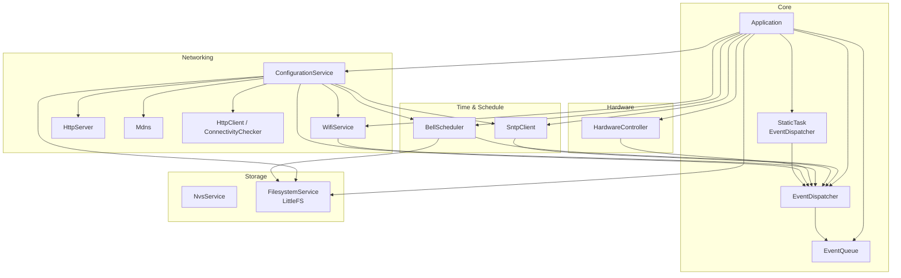
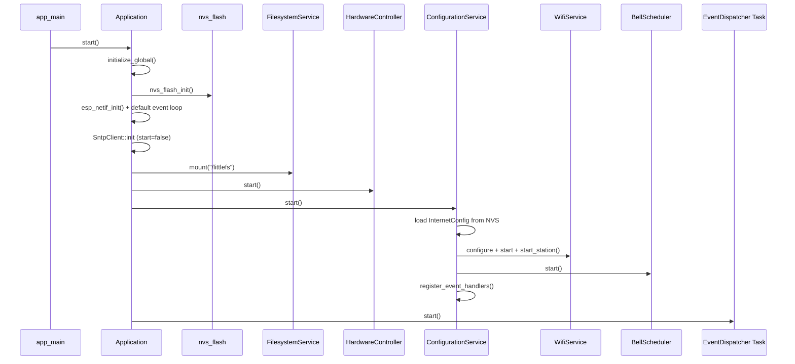
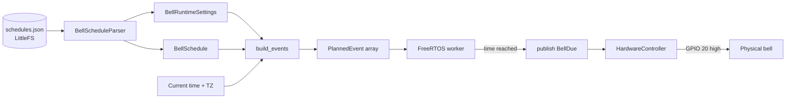

# School Bell System (SBS)

ESP32-C6 firmware for an automated school bell controller.

The device maintains one or more named daily schedules of class periods, synchronises time via SNTP, and drives a physical bell (via GPIO) at the configured start and end times of each period. Wi-Fi credentials and schedules are configured through an embedded web interface served over Wi-Fi (station or access-point mode).

- **Target SoC**: ESP32-C6  
- **Framework**: ESP-IDF 6.1  
- **License**: MIT  
- **Storage**: NVS (Wi-Fi and mode settings) + LittleFS partition labelled `storage` (schedules)

For day-to-day operation, configuration via the web UI, and hardware details, see **[USERMANUAL.md](USERMANUAL.md)**.

---

## Features

- Multiple named schedules with ordered periods (`HH:MM` start/end)
- Automatic bell ringing driven by a rolling short-term event plan
- SNTP time synchronisation once Internet connectivity is available
- Soft-AP fallback / recovery mode for initial setup or lost credentials
- Physical button to toggle configuration mode
- Onboard RGB status LED
- Embedded web UI (Wi-Fi settings + schedule editor)
- mDNS advertisement (`sbs-config.local`) when appropriate
- Type-safe FreeRTOS event bus connecting all subsystems

---

## Hardware Mapping

| Function           | GPIO | Notes                                   |
|--------------------|------|-----------------------------------------|
| Button (input)     | 15   | Active-low, internal pull-up, debounced |
| Bell output        | 20   | Driven high for `bell_duration_ms`      |
| Onboard RGB LED    | 8    | WS2812 via RMT (status indication)      |

Default soft-AP address for the configuration website running: **192.168.0.176**

---

## Software Architecture



The `Application` object owns every major service and performs ordered initialisation. After start-up the system is event-driven.

### Application Startup Sequence



### Event Bus

A compile-time type-safe publish/subscribe layer sits on a FreeRTOS queue. Events are a `std::variant` of payloads (`BellDue`, `WifiStationGotIp`, `ApplicationStateChanged`, `SntpTimeSynced`, …). Each concrete type supports up to eight handlers. A dedicated dispatcher task drains the queue.

| Event                     | Typical producer(s)       | Typical consumer(s)                  |
|---------------------------|---------------------------|--------------------------------------|
| `BellDue`                 | BellScheduler             | HardwareController                   |
| `ApplicationStateChanged` | HardwareController (btn)  | ConfigurationService, HardwareController |
| `WifiStationGotIp`        | WifiService               | ConfigurationService                 |
| `WifiApStarted`           | WifiService               | ConfigurationService                 |
| `SntpTimeSynced`          | SntpClient                | ConfigurationService                 |

### Bell Scheduling Pipeline



---

## Key Components

| Component                          | Responsibility |
|------------------------------------|----------------|
| `Application`                      | Owns services, ordered start-up, global ESP-IDF init |
| `event::EventQueue` / `EventDispatcher` | Type-safe FreeRTOS pub/sub bus |
| `internet::WifiService`            | Station / soft-AP, reconnect policy, event emission |
| `internet::ConfigurationService`   | Mode state machine, web server, mDNS, connectivity probes |
| `scheduler::SntpClient`            | SNTP client with optional DHCP server list |
| `scheduler::BellScheduler`         | JSON schedule parser, rolling event plan, worker task |
| `HardwareController`               | Button, bell GPIO, onboard RGB LED |
| `storage::FilesystemService`       | LittleFS mount / file I/O |
| `storage::NvsService`              | Typed NVS access |
| `internet::HttpServer` / `HttpClient` | Thin ESP-IDF HTTP wrappers |
| `internet::Mdns`                   | mDNS advertisement |
| `StaticTask<T>`                    | Static FreeRTOS task helper calling `T::run()` |

---

## Data Persistence

- **NVS namespace `config`**  
  Station/AP credentials, channel, operating mode, reconnect policy parameters.

- **LittleFS partition `storage` (mounted at `/littlefs`)**  
  File `schedules.json` — timezone, durations, all named schedules and periods.

Both stores are updated only after successful validation of JSON received from the web API.

---

## Timezone Notes

Schedule JSON may contain a timezone field. **IANA names (e.g. `Europe/Vilnius`, `Europe/London`) are implementation-dependent** on ESP-IDF / newlib and are not guaranteed to resolve correctly on all builds.

ESP-IDF prefers the **POSIX timezone form**, for example:

```
GMT0BST,M3.5.0/1,M10.5.0
```

or

```
EET-2EEST,M3.5.0/3,M10.5.0/4
```

When preparing schedules, prefer a POSIX string that matches the desired offset and DST rules. The default schedule currently ships with `"timezone": "Europe/Vilnius"`; replace it with an appropriate POSIX string for reliable behaviour.

---

## Dependencies

Managed via the ESP-IDF Component Manager:

| Component               | Version | Purpose                  |
|-------------------------|---------|--------------------------|
| `espressif/cjson`       | 1.7.19  | JSON parsing/generation  |
| `espressif/led_strip`   | 3.0.3   | WS2812 driver            |
| `espressif/mdns`        | 1.14.1  | mDNS responder           |
| `joltwallet/littlefs`   | 1.22.3  | Flash filesystem         |

ESP-IDF version: 6.1.0 (target `esp32c6`).

---

## Build and Development

```bash
# Select target
idf.py set-target esp32c6

# Optional configuration
idf.py menuconfig

# Build, flash, monitor
idf.py build
idf.py -p /dev/ttyUSB0 flash monitor
```

---

## Known Limitations / Notes

- `ConfigurationService::start_synchronization()` is currently a stub.
- `Application::stop()` is currently a stub.
- Day-of-week selection is not implemented; the active schedule is chosen manually by identifier.
- Connectivity probing uses several well-known captive-portal endpoints after an IP address is obtained.

---

## License

MIT License — see [LICENSE](LICENSE).
