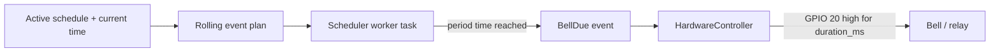

# School Bell System — User Manual

This manual describes how to set up, configure and operate the School Bell System (SBS) running on an ESP32-C6.

For architecture, build instructions and developer information, see **[README.md](README.md)**.

---

## 1. Hardware Overview

| Function        | GPIO | Description                                      |
|-----------------|------|--------------------------------------------------|
| Button          | 15   | Active-low, internal pull-up. Press to enter or leave configuration mode. |
| Bell output     | 20   | Driven high for the configured bell duration. Connect a relay or driver circuit here. |
| Onboard RGB LED | 8    | WS2812 status indicator (green = configuration mode, off = normal). |

Power the board according to the ESP32-C6 module requirements. The bell GPIO is a logic-level output; use an appropriate external driver/relay for any real bell or siren.

---

## 2. First-Time Setup (Soft-AP)

On a fresh device (or when no valid station credentials are stored) the firmware starts a soft access point.

1. Power on the device.
2. On a phone or laptop, join the Wi-Fi network whose SSID defaults to **`Setup`** (password **`Setup123`**).
3. Open a browser and navigate to:

   **http://192.168.0.176**

   This is the default IP address of the configuration website while the device is acting as an access point.

4. You will see the Device Configuration page (Wi-Fi settings). A link at the top also leads to the Schedule editor.

You can also reach the device later via mDNS as **http://sbs-config.local** when the device and your client are on the same network and mDNS is running.

---

## 3. Operating Modes

The device has three conceptual operating modes controlled by the web UI and by the physical button:

| Mode          | Behaviour |
|---------------|-----------|
| **Station (STA)** | Connects to an existing Wi-Fi network using the stored credentials. Normal scheduled operation. |
| **Access Point (AP)** | Creates its own Wi-Fi network so you can connect and configure the device. |
| **AP + STA** | Runs both simultaneously (useful while testing connectivity). |

In addition, the physical button toggles the application between:

- **Running** — normal operation (RGB LED off)
- **Configuration** — forces the configuration website (RGB LED green)

If the station repeatedly fails to connect, a recovery path may automatically start the access point so you can re-enter credentials.

---

## 4. Configuring Wi-Fi

1. Open the configuration website (see section 2).
2. On the main page set:
   - Operating mode (STA / AP / AP+STA)
   - Station SSID and password (the network the device should join)
   - Access-point SSID, password and channel (the network the device creates when in AP mode)
3. Click Save / Submit.
4. The settings are written to non-volatile storage (NVS). The device will apply the new configuration according to the selected mode.

Default values (used when NVS is empty):

- Station: SSID `Test`, password `Test1234`
- Access point: SSID `Setup`, password `Setup123`, channel 1

---

## 5. Configuring Schedules

1. From the configuration website open the **Schedule** page (`/schedule.html`).
2. The page lets you:
   - Create, rename or delete named schedules
   - Choose the currently active schedule
   - Add, edit or remove periods (each period has an ID, start time and end time in `HH:MM` format)
   - Set timezone, bell duration (milliseconds) and optional warning lead time
3. Save the schedule. The new JSON is written to LittleFS (`schedules.json`) and the scheduler immediately recalculates the upcoming bell events.

### Default schedule content

```json
{
  "timezone": "Europe/Vilnius",
  "bell_duration_ms": 1000,
  "warning_lead_time_ms": 5000,
  "active_schedule_id": "weekday",
  "schedules": {
    "weekday": {
      "description": "Weekday bell schedule",
      "periods": [
        { "id": 1, "start": "08:00", "end": "08:45" },
        { "id": 2, "start": "09:00", "end": "09:45" },
        { "id": 3, "start": "10:00", "end": "10:45" }
      ]
    },
    "weekend": {
      "description": "Weekend bell schedule",
      "periods": [
        { "id": 1, "start": "09:00", "end": "09:45" },
        { "id": 2, "start": "10:00", "end": "10:45" }
      ]
    }
  }
}
```

Edit the periods to match your school timetable. The scheduler currently rings at both the start and the end of each period (subject to the planning horizon).

---

## 6. Timezone Important Note

The `timezone` field in the schedule JSON is passed to the C library’s timezone handling.

**IANA names** such as `Europe/Vilnius` or `Europe/London` are **implementation-dependent**. On ESP-IDF / newlib they are not guaranteed to resolve correctly on every build or board.

**Prefer the POSIX timezone form**, for example:

```
GMT0BST,M3.5.0/1,M10.5.0
```

or

```
EET-2EEST,M3.5.0/3,M10.5.0/4
```

These strings encode the base offset and the daylight-saving rules explicitly and are the form ESP-IDF expects. Replace the default IANA string with a suitable POSIX string for reliable local-time conversion.

---

## 7. How the Bell Works



1. The scheduler loads `schedules.json` and the active schedule.
2. It builds a short-term plan of absolute timestamps for the next planning horizon (default 36 hours).
3. A background FreeRTOS task sleeps until the next planned instant.
4. When that instant arrives it publishes a `BellDue` event containing the configured duration.
5. The hardware controller asserts GPIO 20 for exactly that duration, then releases it.

Accurate wall-clock time is obtained via SNTP after the device obtains an IP address and Internet connectivity is confirmed.

---

## 8. Web Interface Endpoints

| Path             | Method   | Purpose                              |
|------------------|----------|--------------------------------------|
| `/`              | GET      | Wi-Fi & operating-mode form          |
| `/schedule.html` | GET      | Schedule editor                      |
| `/style.css`     | GET      | Stylesheet                           |
| `/script.js`     | GET      | Wi-Fi configuration logic            |
| `/schedule.js`   | GET      | Schedule editor logic                |
| `/api/config`    | GET/POST | Read / write Wi-Fi and mode settings |
| `/api/schedule`  | GET/POST | Read / write the schedule JSON       |

All configuration changes are validated before being written to NVS or LittleFS.

---

## 9. Status Indication

| RGB LED colour | Meaning                |
|----------------|------------------------|
| Off            | Normal / Running mode  |
| Green (dim)    | Configuration mode     |

The physical button on GPIO 15 toggles between these two states. Holding the device in configuration mode starts (or keeps) the access point and the web server so you can adjust settings.

---

## 10. Typical Daily Operation

1. Device boots, joins the configured Wi-Fi network (STA mode).
2. Obtains an IP address and starts SNTP.
3. After time is synchronised the scheduler recalculates the plan from the active schedule.
4. At each planned period boundary the bell GPIO is pulsed for the configured duration.
5. If connectivity is lost for a prolonged period the recovery logic may open the soft-AP so credentials can be corrected.

No user interaction is required once the schedule and Wi-Fi settings are correct.

---

## 11. Troubleshooting

| Symptom | Possible cause / action |
|---------|-------------------------|
| Cannot join the soft-AP | Confirm SSID `Setup` / password `Setup123`. Reboot the device. |
| Browser cannot open 192.168.0.176 | Ensure the client is connected to the device’s AP and has obtained a DHCP address in the 192.168.0.x range. |
| Bells ring at the wrong time | Check the timezone string (prefer POSIX form — see section 6). Verify SNTP has synchronised (device must have Internet access). |
| No bells at all | Confirm the active schedule contains periods, the schedule file was saved successfully, and the system clock is valid. |
| Device never joins the home network | Re-enter station SSID/password via the configuration website. Check that the network is 2.4 GHz (ESP32-C6 supports both bands, but verify your router settings). |
| Button does nothing | Verify the button is wired to GPIO 15 with the correct polarity (active-low). |

---

## 12. Factory Defaults Summary

| Setting              | Default value          |
|----------------------|------------------------|
| Soft-AP SSID         | `Setup`                |
| Soft-AP password     | `Setup123`             |
| Soft-AP IP           | **192.168.0.176**        |
| Station SSID         | `Test`                 |
| Station password     | `Test1234`             |
| Operating mode       | Access Point           |
| Timezone (schedule)  | `Europe/Vilnius` (replace with POSIX form) |
| Bell duration        | 1000 ms                |
| Warning lead time    | 5000 ms                |

---

## 13. Safety Notes

- GPIO 20 is a logic-level output. Always use a suitable relay or driver circuit when controlling mains-powered bells or sirens.
- Ensure the enclosure and wiring comply with local electrical regulations.
- The device is intended for continuous indoor operation.